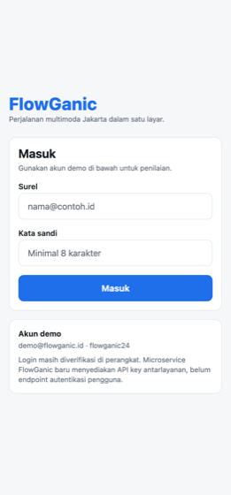
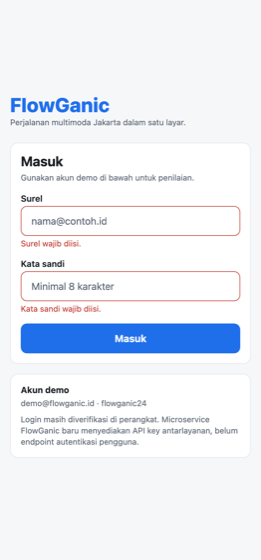
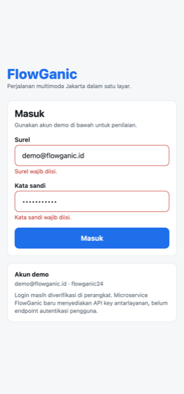
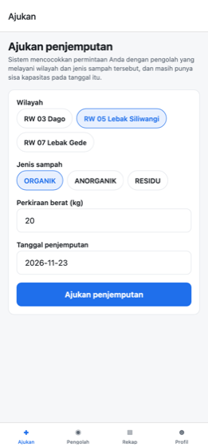
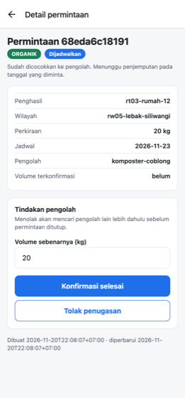
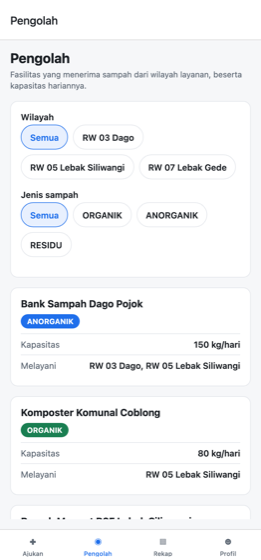
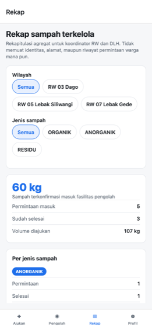
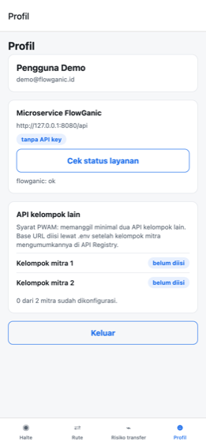

# FlowGanic

Platform koordinasi digital berbasis data untuk distribusi sampah Kota Bandung, dikerjakan untuk Tugas 2 II3160 TST × II3140 PWAM. Satu repositori memuat dua bagian: microservice di root dan aplikasi React Native (Expo) di `mobile/`, yang didokumentasikan pada bagian PWAM di akhir dokumen ini. Layanan integrasi lintas kelompok dikerjakan pada Tugas 3.

| | |
| --- | --- |
| Kelompok | `kononkatanya` (K01) |
| Base URL | **https://kononkatanya.stei.fun/api** |
| Dokumentasi interaktif | **https://kononkatanya.stei.fun/api/docs** |
| Repositori | https://github.com/tepchu/FlowGanic |
| Autentikasi | Header `X-API-Key` pada semua endpoint kecuali `/health` |
| Wilayah pilot | RW 05 Lebak Siliwangi, Kecamatan Coblong |

## Masalah yang diselesaikan

Penghasil sampah, pengolah, koordinator wilayah, dan dinas bekerja terpisah, sehingga informasi tentang sampah yang dihasilkan dan yang berhasil dikelola tidak saling terhubung. FlowGanic menghubungkan keempat pihak itu dalam satu alur yang terlacak.

Rumah tangga mengajukan permintaan penjemputan dengan menyebutkan jenis sampah, perkiraan volume, dan tanggal yang diinginkan. Sistem mencocokkannya dengan pengolah yang melayani wilayah dan jenis tersebut serta masih memiliki sisa kapasitas pada tanggal itu. Pengolah dapat menolak penugasan, dan saat sampah diterima, pengolah mengonfirmasi volume sebenarnya. Koordinator RW dan DLH membaca rekap agregat yang tidak pernah menunjuk rumah tangga mana pun.

## Status implementasi

| Bagian | Status |
| --- | --- |
| Wilayah, pengolah, permintaan, rekap | Berjalan dengan **data contoh** |
| Pencocokan pengolah berbasis kapasitas harian | Berjalan dan teruji |
| Docker Compose, gateway Nginx, batas CPU/memori | Berjalan dan terverifikasi di STB |
| Akses publik HTTPS via Cloudflare Tunnel | Berjalan dan terverifikasi dari luar jaringan STB |
| Autentikasi `X-API-Key` | Berjalan dan terverifikasi dari internet |
| OpenAPI, Swagger UI, tes Python, `cek-api.sh` | Tersedia |
| Aplikasi mobile Expo | Kerangka selesai, lihat bagian PWAM |
| Entri API Registry | Belum didaftarkan |
| Notifikasi, peta dan geocoding, autentikasi pengguna | Belum diimplementasikan |

Tiga wilayah, empat pengolah, dan seluruh kapasitasnya adalah **data contoh** untuk menguji alur koordinasi, bukan data operasional Kota Bandung. Setiap respons memuat label `sumber` agar batasan ini terlihat oleh pemakai API.

## Bounded context dan pemetaannya ke endpoint

Tugas 1 memecah domain menjadi tiga konteks. Pembagian itu dipertahankan apa adanya di API:

| Bounded context | Peran | Endpoint |
| --- | --- | --- |
| **Koordinasi Distribusi Sampah** (core) | Pengajuan, pencocokan, penjadwalan, pelacakan status dan volume | `POST /permintaan`, `GET /permintaan/{id}`, `PATCH /permintaan/{id}` |
| **Identitas dan Wilayah** (supporting) | Wilayah layanan dan profil pengolah | `GET /wilayah`, `GET /pengolah` |
| **Analitik dan Pelaporan** (supporting) | Rekapitulasi agregat dan anonim | `GET /rekap` |

Konteks hilir hanya membaca hitungan dan volume, tidak pernah isi permintaan maupun identitas penghasil. Itu sebabnya `/rekap` tidak mengembalikan `penghasil_ref` maupun id permintaan.

Dua aturan bisnis dari Tugas 1 diterapkan dan dikunci oleh tes:

- **Pengiriman ulang tidak menggandakan permintaan.** Pengajuan dengan penghasil, wilayah, jenis, dan jadwal yang sama mengembalikan permintaan yang sudah ada dengan `duplikat: true` dan kode 200, bukan membuat baris baru.
- **Pemilik permintaan tidak dapat diubah.** `PATCH` hanya menyentuh status, pengolah, dan volume.

## Arsitektur

```
Aplikasi mobile / kelompok mitra
            │  HTTPS
            ▼
   Cloudflare edge  ──────────────────────────────┐
            │  tunnel terenkripsi                 │
            ▼                                     │
┌─ STB Armbian ARM64 ────────────────────────────┐│
│  cloudflared (systemd service di host)         ││
│            │  http://127.0.0.1:80              ││
│            ▼                                   ││
│  ┌─ Docker ───────────────────────────────┐    ││
│  │  gateway (Nginx)   0,25 CPU · 64 MB    │    ││
│  │            │  http://core-service:8000 │    ││
│  │            ▼                           │    ││
│  │  core-service      0,5 CPU · 256 MB    │    ││
│  │            │                           │    ││
│  │            ▼                           │    ││
│  │  volume flowganic-data (SQLite)        │    ││
│  └────────────────────────────────────────┘    ││
└────────────────────────────────────────────────┘│
   Tidak ada port STB yang dibuka ke internet ────┘
```

| Komponen | Teknologi | Fungsi | Batas sumber daya |
| --- | --- | --- | --- |
| `core-service` | Python 3.12 standard library, SQLite | Wilayah, pengolah, permintaan, pencocokan, rekap, pemeriksaan API key | 0,5 CPU · 256 MB |
| `gateway` | Nginx 1.28 Alpine | Meneruskan `/api/*`, menyajikan `/api/docs`, membatasi 5 req/detik per IP | 0,25 CPU · 64 MB |
| `cloudflared` | Cloudflare Tunnel | HTTPS publik tanpa membuka port | service host |

Core service dan database tidak mempublikasikan port sama sekali. Gateway hanya terikat ke `127.0.0.1` di STB, sehingga tidak terjangkau dari jaringan lokal maupun internet kecuali melalui tunnel. Semua container memakai `restart: unless-stopped` agar hidup kembali setelah listrik padam.

Perutean di sisi Cloudflare memisahkan dua layanan pada hostname yang sama: path `^/api(/.*)?$` diteruskan ke gateway ini, sedangkan path lain diarahkan ke panel administrasi STB di port 1122 dan tidak pernah menyentuh microservice. Karena itu gateway hanya perlu mengenal `/api`, dan menjawab 404 untuk selebihnya.

## Daftar endpoint

Base URL: `https://kononkatanya.stei.fun/api`. Spesifikasi mesin ada di [`openapi.yaml`](openapi.yaml) dan disajikan pada `https://kononkatanya.stei.fun/api/openapi.yaml`.

Dokumentasi interaktif tersedia di **https://kononkatanya.stei.fun/api/docs**. Tekan **Authorize**, masukkan API key, lalu setiap endpoint dapat dicoba langsung dari peramban lewat tombol **Try it out** tanpa perlu curl atau Postman.

| Metode | Path | Kunci | Masukan | Keluaran |
| --- | --- | --- | --- | --- |
| GET | `/health` | tidak | — | Status service |
| GET | `/wilayah` | ya | — | Wilayah layanan, pilot ditandai |
| GET | `/pengolah` | ya | Query `wilayah_id`, `jenis` | Pengolah, kapasitas, cakupan layanan |
| POST | `/permintaan` | ya | JSON pengajuan penjemputan | Permintaan beserta pengolah hasil pencocokan |
| GET | `/permintaan/{id}` | ya | — | Status terkini permintaan |
| PATCH | `/permintaan/{id}` | ya | JSON `aksi`, `volume_kg` | Permintaan setelah diperbarui |
| GET | `/rekap` | ya | Query `wilayah_id`, `jenis`, `dari`, `sampai` | Total dan rincian per jenis |

Status permintaan: `diajukan` belum ada pengolah yang sanggup pada tanggal itu, `dijadwalkan` sudah dicocokkan, `ditolak` tidak ada pengolah yang dapat melayani, `selesai` volume sudah dikonfirmasi.

Kode galat: `400` masukan tidak valid atau permintaan sudah final, `401` API key salah atau belum disertakan, `404` wilayah, permintaan, atau endpoint tidak ditemukan, `429` melewati batas pemanggilan.

## Cara mendapat akses

Semua endpoint kecuali `/health` memerlukan header `X-API-Key`. `/health` sengaja dibiarkan terbuka agar status layanan dan tunnel dapat diperiksa tanpa kredensial.

Kelompok lain yang ingin memakai API ini silakan menghubungi anggota kelompok untuk mendapat API key dan akun uji. Mitra integrasi yang direncanakan pada Tugas 1 adalah kelompok bertema Pendidikan, yang memakai rekap agregat sebagai bahan edukasi pemilahan sampah. **Pertukaran data dibatasi pada `/wilayah`, `/pengolah`, dan `/rekap`**; akun, alamat, dan riwayat permintaan warga tidak pernah dibuka.

Gateway membatasi 5 request per detik per alamat IP dengan burst 20; lampaui itu dan jawabannya `429`. Kunci tidak pernah disimpan di repositori, nilainya hanya ada pada `.env` di STB.

## Contoh request

```sh
# Tanpa kunci: hanya health yang terbuka
curl https://kononkatanya.stei.fun/api/health

KUNCI=<api-key-dari-kelompok>

curl -H "X-API-Key: $KUNCI" https://kononkatanya.stei.fun/api/wilayah

curl -H "X-API-Key: $KUNCI" \
  'https://kononkatanya.stei.fun/api/pengolah?wilayah_id=rw05-lebak-siliwangi&jenis=ORGANIK'

# Ajukan penjemputan
curl -X POST https://kononkatanya.stei.fun/api/permintaan \
  -H "X-API-Key: $KUNCI" -H 'Content-Type: application/json' \
  -d '{"penghasil_ref":"rt03-rumah-12","wilayah_id":"rw05-lebak-siliwangi",
       "jenis":"ORGANIK","perkiraan_kg":20,"jadwal":"2026-11-25"}'

# Pengolah mengonfirmasi volume yang benar-benar masuk
curl -X PATCH https://kononkatanya.stei.fun/api/permintaan/<id> \
  -H "X-API-Key: $KUNCI" -H 'Content-Type: application/json' \
  -d '{"aksi":"selesai","volume_kg":23}'

curl -H "X-API-Key: $KUNCI" \
  'https://kononkatanya.stei.fun/api/rekap?wilayah_id=rw05-lebak-siliwangi'
```

Contoh respons:

```json
// POST /api/permintaan
{
  "id": "68eda6c18191",
  "penghasil_ref": "rt03-rumah-12",
  "wilayah_id": "rw05-lebak-siliwangi",
  "jenis": "ORGANIK",
  "perkiraan_kg": 20,
  "jadwal": "2026-11-25",
  "status": "dijadwalkan",
  "pengolah_id": "komposter-coblong",
  "volume_kg": null,
  "duplikat": false
}

// GET /api/rekap
{
  "total": {
    "permintaan": 4, "selesai": 3,
    "terkelola_kg": 60, "diajukan_kg": 87
  },
  "per_jenis": {
    "ORGANIK":   {"permintaan": 2, "selesai": 2, "terkelola_kg": 48},
    "ANORGANIK": {"permintaan": 1, "selesai": 1, "terkelola_kg": 12},
    "RESIDU":    {"permintaan": 1, "selesai": 0, "terkelola_kg": 0}
  },
  "sumber": "agregat_anonim"
}

// Tanpa X-API-Key
{"galat": "API key tidak valid atau belum disertakan"}
```

Seluruh endpoint dapat diuji sekaligus, termasuk alur dari pengajuan sampai konfirmasi volume:

```sh
API_KEY=<kunci> sh cek-api.sh https://kononkatanya.stei.fun/api
```

## Struktur repo

| Path | Isi |
| --- | --- |
| `core-service/app.py` | Model domain, pencocokan pengolah, rekap, pemeriksaan API key |
| `core-service/test_app.py` | Tes domain, aturan bisnis, lapisan HTTP, dan autentikasi |
| `core-service/Dockerfile` | Image backend ARM64, berjalan sebagai pengguna non-root |
| `gateway/nginx.conf` | Reverse proxy, rate limit, penyajian dokumentasi |
| `gateway/public/docs/` | Halaman Swagger UI |
| `compose.yaml` | Core service, gateway, tunnel opsional |
| `openapi.yaml` | Kontrak tujuh endpoint |
| `cek-api.sh` | Skrip uji empat belas pemeriksaan HTTP |
| `mobile/` | Aplikasi React Native (Expo) untuk PWAM |
| `mobile/docs/` | Tangkapan layar aplikasi |
| `.env.example` | Nama variabel rahasia tanpa nilainya |

## Jalankan di laptop

Syarat: Docker Engine dan Docker Compose.

```sh
cp .env.example .env     # isi API_KEY bila ingin menguji autentikasi
docker compose up -d --build
docker compose ps
sh cek-api.sh
```

Tes tanpa Docker:

```sh
cd core-service
python3 -m unittest -v
```

## Deploy ke STB

1. STB Armbian ARM64 dengan Docker dan Compose. Periksa dahulu port yang masih bebas, karena satu STB dapat menampung deployment lain:

   ```sh
   docker ps --format '{{.Names}}\t{{.Ports}}'
   ss -tlnp
   ```

2. Clone repo, lalu buat `.env`. Kunci dibuat di STB dan tidak pernah masuk Git:

   ```sh
   printf 'GATEWAY_PORT=80\nAPI_KEY=%s\n' "$(openssl rand -hex 24)" > .env
   chmod 600 .env
   docker compose up -d --build
   ```

3. Pastikan batas sumber daya benar-benar berlaku di kernel STB:

   ```sh
   docker inspect flowganic-core-service-1 flowganic-gateway-1 \
     --format '{{.Name}} {{.HostConfig.NanoCpus}} {{.HostConfig.Memory}}'
   ```

   Harus mengembalikan `CPU=500000000 MEM=268435456` dan `CPU=250000000 MEM=67108864`. Bila `MEM=0`, kernel STB belum mengaktifkan memory cgroup.

4. Pasang cloudflared dengan token tunnel dari asisten kelas:

   ```sh
   curl -fsSL https://pkg.cloudflare.com/cloudflare-main.gpg | tee /usr/share/keyrings/cloudflare-main.gpg >/dev/null
   echo 'deb [signed-by=/usr/share/keyrings/cloudflare-main.gpg] https://pkg.cloudflare.com/cloudflared any main' > /etc/apt/sources.list.d/cloudflared.list
   apt-get update; apt-get install -y cloudflared
   cloudflared service install <TOKEN>
   systemctl status cloudflared --no-pager
   ```

   Public Hostname diatur bertipe `HTTP` ke `localhost:80`, sesuai `GATEWAY_PORT`. Bila jaringan memblokir QUIC, tambahkan `--protocol http2` pada perintah layanan.

5. Verifikasi dari luar jaringan STB:

   ```sh
   sh cek-api.sh https://kononkatanya.stei.fun/api
   ```

Bila tunnel inactive, periksa koneksi STB dan token. Bila `502`, periksa URL Public Hostname dan status container. Bila `404` pada `/api/*`, besar kemungkinan Public Hostname menunjuk layanan lain di STB yang sama.

## Perawatan

```sh
docker compose logs core-service --tail 50
systemctl status cloudflared --no-pager
docker stats --no-stream
docker compose cp core-service:/data/flowganic.db ./backup-$(date +%F).db
```

Backup sebaiknya diambil saat layanan dihentikan agar salinannya konsisten, dan disimpan di luar repositori.

## Pemeriksaan yang sudah dilakukan

Per 20 November 2026:

| Pemeriksaan | Hasil |
| --- | --- |
| `python3 -m unittest` | 17 tes lulus |
| `docker compose config` | Valid |
| Batas CPU/memori di STB | `500000000`/`268435456` dan `250000000`/`67108864` |
| `cek-api.sh` terhadap container | 14 dari 14 lulus |
| `GET /api/health` dari luar jaringan STB | `200`, HTTP/2 over TLS |
| Endpoint berkunci tanpa `X-API-Key` dari internet | `401` |

Belum diuji: beban bersamaan, perilaku setelah listrik STB padam, dan tampilan aplikasi mobile di perangkat fisik.

## Bagian PWAM: aplikasi mobile

Bagian berikut mendokumentasikan aplikasi React Native (Expo) yang mengonsumsi microservice di atas. Sumbernya ada pada `mobile/` di repositori yang sama.

Aplikasi React Native (Expo) untuk II3140 PWAM. Mengonsumsi microservice FlowGanic, platform koordinasi distribusi sampah Kota Bandung, yang berjalan di STB dan dapat diakses publik di `https://kononkatanya.stei.fun/api`, sebagaimana dijabarkan pada bagian sebelumnya.

| | |
| --- | --- |
| Kerangka | Expo SDK 58, React Native 0.88, React 19 |
| Navigasi | React Navigation: native stack + bottom tabs |
| Bahasa | JavaScript, tanpa TypeScript |
| Penyimpanan sesi | AsyncStorage |
| Akun demo | `demo@flowganic.id` / `flowganic24` |

### Kerangka aplikasi

Struktur dipisah menurut peran agar tiap bagian dapat diuji dan diganti sendiri-sendiri.

| Path | Peran |
| --- | --- |
| `App.js` | Menyusun navigasi dan membungkus aplikasi dengan penyedia sesi |
| `src/api/ApiService.js` | Satu-satunya tempat pemanggilan HTTP keluar |
| `src/api/konfigurasi.js` | Base URL, API key, akun demo, kode penghasil |
| `src/konteks/SesiContext.js` | Status login, simpan dan hapus sesi |
| `src/layar/` | Lima layar aplikasi |
| `src/ui/komponen.js` | Komponen pakai-ulang: Wadah, Kartu, Kolom, Pilihan, Baris, Tombol, Pesan, Lencana |
| `src/ui/responsif.js` | Titik ubah mobile first |
| `src/ui/tema.js` | Warna jenis sampah, warna status, jarak |

Aturan yang dipegang: layar tidak pernah memanggil `fetch` sendiri, selalu lewat `ApiService`. Tidak ada URL atau kunci yang ditulis di dalam kode; semuanya dari `.env`.

### Navigasi

Dua lapis. Stack terluar menentukan pengguna sudah masuk atau belum; tab hanya hidup setelah login.

```
Stack (navigator terluar)
│
├── Masuk                      ← tampil bila belum ada sesi
│
└── Utama                      ← tampil bila sesi ada
    │
    ├── Tab
    │   ├── Ajukan             form penjemputan + permintaan terakhir
    │   ├── Pengolah           fasilitas penerima dan kapasitasnya
    │   ├── Rekap              rekapitulasi agregat
    │   └── Profil             status layanan dan keluar
    │
    └── DetailPermintaan       ← didorong dari Ajukan
```

Peralihan masuk dan keluar tidak memakai perintah navigasi. `SesiContext` mengubah status, lalu stack merender cabang yang sesuai. Akibatnya layar bertab tidak mungkin terbuka tanpa sesi, dan tombol kembali tidak dapat mengembalikan pengguna ke halaman dalam setelah keluar.

### Layar

| Layar | Letak | Isi | Endpoint |
| --- | --- | --- | --- |
| Masuk | Stack | Form surel dan kata sandi, validasi, pesan galat | — |
| Ajukan | Tab | Pilih wilayah dan jenis, isi berat dan tanggal, lalu daftar permintaan terakhir | `GET /wilayah`, `POST /permintaan`, `GET /permintaan/{id}` |
| Pengolah | Tab | Daftar fasilitas dengan saringan wilayah dan jenis | `GET /wilayah`, `GET /pengolah` |
| Rekap | Tab | Total terkelola dan rincian per jenis sampah | `GET /wilayah`, `GET /rekap` |
| Profil | Tab | Identitas pengguna, base URL, cek status layanan, status mitra, keluar | `GET /health` |
| DetailPermintaan | Stack | Status, pengolah hasil pencocokan, tindakan pengolah | `GET /permintaan/{id}`, `PATCH /permintaan/{id}` |

Tiap layar yang memanggil jaringan memiliki tiga keadaan: sedang memuat dengan indikator, berhasil, dan gagal dengan pesan beserta tombol coba lagi. Layar yang menampilkan data contoh selalu menyertakan label sumbernya, sehingga pengguna tidak menyangka itu informasi operasional.

### Login dan sesi

Validasi dijalankan di perangkat sebelum apa pun dikirim:

| Kolom | Aturan |
| --- | --- |
| Surel | Wajib diisi, harus berpola `nama@domain.tld` |
| Kata sandi | Wajib diisi, minimal 8 karakter |

Pesan galat muncul tepat di bawah kolom yang bersangkutan, dan kolomnya diberi garis tepi berbeda. Bila keduanya lolos, kredensial dicocokkan dengan akun demo; bila cocok, sesi disimpan ke AsyncStorage sehingga pengguna tetap masuk setelah aplikasi ditutup.

Login ini **diverifikasi di perangkat, bukan di server**. Microservice FlowGanic baru menyediakan API key antarlayanan dan belum memiliki endpoint autentikasi pengguna, jadi belum ada token yang diterbitkan server. Batasan ini ditulis terbuka di layar Masuk agar tidak disalahartikan sebagai autentikasi sungguhan. Bila endpoint autentikasi ditambahkan kelak, hanya `SesiContext` dan `ApiService` yang perlu berubah; layar tidak tersentuh.

Pengguna diwakili kode anonim `rt03-rumah-12`, bukan nama atau alamat, sesuai batasan privasi pada Tugas 1.

### Pemanggilan API sendiri

Seluruh lalu lintas keluar melewati satu fungsi di `ApiService.js` yang menangani batas waktu, penyisipan header, penguraian JSON, dan penyeragaman galat.

| Fungsi | Memanggil |
| --- | --- |
| `ApiFlowGanic.cekKesehatan()` | `GET /health`, sengaja tanpa kunci |
| `ApiFlowGanic.ambilWilayah()` | `GET /wilayah` |
| `ApiFlowGanic.ambilPengolah(wilayahId, jenis)` | `GET /pengolah` |
| `ApiFlowGanic.ajukanPermintaan({...})` | `POST /permintaan` |
| `ApiFlowGanic.lacakPermintaan(id)` | `GET /permintaan/{id}` |
| `ApiFlowGanic.perbaruiPermintaan(id, aksi, volumeKg)` | `PATCH /permintaan/{id}` |
| `ApiFlowGanic.ambilRekap({...})` | `GET /rekap` |

Header `X-API-Key` disisipkan otomatis bila `EXPO_PUBLIC_API_KEY` terisi. Permintaan dibatalkan setelah 10 detik agar aplikasi tidak menggantung saat jaringan buruk. Setiap kegagalan dilempar sebagai `GalatApi` dengan pesan berbahasa Indonesia yang layak ditampilkan ke pengguna:

| Keadaan | Pesan |
| --- | --- |
| Kode 400 | Pesan dari server, misalnya jadwal sudah lewat |
| Kode 401 | API key ditolak layanan |
| Kode 404 | Pesan dari server, misalnya wilayah tidak ditemukan |
| Kode 429 | Terlalu sering memanggil, coba lagi sebentar lagi |
| Batas waktu | Layanan tidak menjawab tepat waktu |
| Jaringan mati | Tidak dapat menghubungi layanan, periksa koneksi |

Kerangka pemanggilan API kelompok lain sudah disiapkan pada objek `MITRA`, namun base URL-nya sengaja dibiarkan kosong karena integrasi lintas kelompok merupakan lingkup Tugas 3.

### Tangkapan layar

Diambil pada 20 November 2026 dari aplikasi yang berjalan, viewport 420 × 900. Seluruh data pada gambar berasal dari pemanggilan API sungguhan, bukan tiruan.

Pada sesi ini aplikasi diarahkan ke instans microservice lokal yang kodenya identik dengan yang berjalan di STB, sehingga API key produksi tidak ikut terekam dalam gambar. Itu sebabnya layar Profil menampilkan base URL lokal.

#### Login dan validasi

| Layar Masuk | Validasi kolom kosong | Kredensial terisi |
| --- | --- | --- |
|  |  |  |

Menekan **Masuk** tanpa mengisi apa pun memunculkan pesan galat di bawah tiap kolom beserta garis tepi merah, dan tidak ada permintaan jaringan yang dikirim.

#### Alur inti: mengajukan dan melacak penjemputan

| Ajukan penjemputan | Detail permintaan |
| --- | --- |
|  |  |

Wilayah dan jenis sampah dipilih lewat chip, bukan picker, agar tetap nyaman disentuh pada layar sempit. Setelah dikirim, `POST /permintaan` mengembalikan permintaan beserta pengolah hasil pencocokan, dan aplikasi mendorong layar DetailPermintaan di atas tab melalui stack. Di layar itu tampak status `Dijadwalkan` dan pengolah `komposter-coblong` yang dipilih sistem berdasarkan wilayah, jenis sampah, dan sisa kapasitas hari tersebut. Tombol **Konfirmasi selesai** dan **Tolak penugasan** memanggil `PATCH /permintaan/{id}`.

#### Pengolah dan rekap

| Pengolah | Rekap |
| --- | --- |
|  |  |

Tab Pengolah menyaring `GET /pengolah` per wilayah dan jenis, menampilkan kapasitas harian serta seluruh cakupan layanan tiap fasilitas. Tab Rekap membaca `GET /rekap`: total sampah terkonfirmasi masuk fasilitas, jumlah permintaan, dan rincian per jenis. Inilah bentuk data yang dibagikan ke kelompok mitra pada Tugas 3, dan tidak satu pun barisnya menunjuk rumah tangga tertentu.

| Profil |
| --- |
|  |

Profil memanggil `GET /health` dan menampilkan `flowganic: ok`, sekaligus menunjukkan status konfigurasi mitra Tugas 3 yang memang belum diisi.

Keempat tab terlihat pada bilah bawah di setiap gambar, dan tab yang sedang aktif ditandai berbeda dari yang lain. Itu bukti navigasi tab bekerja; layar DetailPermintaan yang tampil dengan tombol kembali dan tanpa bilah tab adalah bukti stack bekerja.

### Menjalankan

Syarat: Node.js 22 dan npm.

```sh
cd mobile
npm install
cp .env.example .env
```

Isi `EXPO_PUBLIC_API_KEY` pada `.env` dengan kunci dari kelompok. `EXPO_PUBLIC_API_URL` sudah menunjuk layanan publik, sehingga aplikasi tidak memerlukan backend lokal maupun jaringan yang sama dengan STB.

```sh
npx expo start
```

Tekan `w` untuk peramban, `a` untuk emulator Android, atau pindai kode QR dengan Expo Go pada perangkat sungguhan. Masuk memakai akun demo di tabel paling atas.

| Variabel | Isi |
| --- | --- |
| `EXPO_PUBLIC_API_URL` | Base URL microservice, berakhiran `/api` |
| `EXPO_PUBLIC_API_KEY` | API key, dikirim sebagai header `X-API-Key` |
| `EXPO_PUBLIC_MITRA1_*` | Disiapkan untuk Tugas 3, dibiarkan kosong |
| `EXPO_PUBLIC_MITRA2_*` | Disiapkan untuk Tugas 3, dibiarkan kosong |

### Pendekatan mobile first

Gaya dasar ditulis untuk layar ponsel paling sempit tanpa mengasumsikan ruang lebih. Penyesuaian hanya ditambahkan ketika lebar layar mencapai minimum tertentu, sejalan dengan pola `min-width`.

| Titik ubah | Lebar minimum | Penyesuaian |
| --- | --- | --- |
| dasar | 0 | Satu kolom, padding 16, chip membungkus ke baris berikutnya |
| sedang | 600 | Lebar konten dibatasi 680, padding 24, judul membesar |
| lebar | 900 | Lebar konten dibatasi 900 |

React Native tidak mengenal media query CSS, jadi titik ubah dibaca lewat `useWindowDimensions` pada `src/ui/responsif.js`. Pembantu `perLebar({ dasar, sedang, lebar })` mewajibkan nilai `dasar` dan hanya menimpanya bila ambang tercapai, sehingga tata letak ponsel menjadi jalur bawaan, bukan hasil penyusutan dari tata letak lebar.

Target sentuh tombol, chip, dan kolom isian dijaga minimal 40 pt. Semua layar memakai `ScrollView` agar tetap terpakai pada layar pendek ketika papan ketik terbuka.

### Status

| Bagian | Keadaan |
| --- | --- |
| Kerangka, navigasi stack dan tab, lima layar | Selesai |
| Login dan form dengan validasi | Selesai, diverifikasi di perangkat |
| Pemanggilan ketujuh endpoint microservice sendiri | Selesai, teruji terhadap layanan yang berjalan |
| Panggilan API kelompok lain | Lingkup Tugas 3, kerangka sudah disiapkan |
| Branding, ikon, splash | Belum dikerjakan |
| Build APK release | Belum dikerjakan |

Belum diuji: tampilan pada perangkat fisik dan alur login melalui antarmuka perangkat sungguhan.

## Pengumpulan

Tugas 2 meminta URL microservice publik, URL repositori, dan `README.pdf` berisi arsitektur, daftar endpoint, cara mendapat akses, serta contoh request. Dokumen ini menggabungkan keduanya: bagian microservice untuk TST dan bagian PWAM untuk aplikasi mobile, sehingga cukup satu berkas yang dikumpulkan. Milestone Base URL dan dokumentasi di API Registry: akhir Minggu 14 (29 November 2026). Pengumpulan akhir: 13 Desember 2026, 23.59 WIB.

Jangan mengunggah `.env`, database lokal, cache, atau direktori `ponytail-main`.
