Tugas Kelompok Pengembangan Aplikasi Web dan Mobile (II3140) x Teknologi Sistem Terintegrasi (II3160) 2026 — Tugas Besar (2): Dokumentasi Aplikasi dan Microservice

# FlowGanic: Dokumentasi Kerangka Aplikasi, Navigasi, Layar, Login, dan API {.unnumbered}

Disusun oleh Kelompok **kononkatanya** (K01)

| NIM | Nama |
| --- | --- |
| 18224067 | Bryant Azraqi Mohammad |
| 18224117 | Stephanie Mae |

Link repositori (microservice dan aplikasi mobile): https://github.com/tepchu/FlowGanic

Base URL microservice: https://kononkatanya.stei.fun/api

Program Studi Sistem dan Teknologi Informasi

Sekolah Teknik Elektro dan Informatika

Institut Teknologi Bandung

2026

```{=openxml}
<w:p><w:r><w:br w:type="page"/></w:r></w:p>
```

# DAFTAR ISI {.unnumbered}

BAB 1 KERANGKA APLIKASI

BAB 2 NAVIGASI DAN LAYAR

BAB 3 LOGIN DAN AUTENTIKASI

BAB 4 API

```{=openxml}
<w:p><w:r><w:br w:type="page"/></w:r></w:p>
```

# BAB 1 KERANGKA APLIKASI

FlowGanic adalah platform koordinasi distribusi sampah Kota Bandung dengan wilayah pilot RW 05 Lebak Siliwangi, Kecamatan Coblong. Penghasil sampah, pengolah, koordinator RW, dan dinas selama ini bekerja terpisah sehingga informasi tentang sampah yang dihasilkan dan yang berhasil dikelola tidak saling terhubung. FlowGanic menyatukan keempat pihak itu dalam satu alur yang terlacak: rumah tangga mengajukan penjemputan, sistem mencocokkannya dengan pengolah yang masih memiliki sisa kapasitas, pengolah mengonfirmasi volume yang benar-benar diterima, dan koordinator membaca rekap agregat yang tidak pernah menunjuk rumah tangga mana pun.

Pekerjaan ini terdiri atas dua bagian dalam satu repositori. Microservice ditulis dengan Python 3.12 dan berjalan di STB sebagai container Docker, sedangkan aplikasi mobile dibangun dengan React Native, yaitu kerangka kerja untuk membuat aplikasi Android dan iOS dari satu basis kode JavaScript, dan dijalankan memakai Expo, yaitu perangkat bantu yang menyederhanakan pengembangan dan pengujian React Native. Seluruh data wilayah, pengolah, permintaan, dan rekap berasal dari microservice, sehingga aplikasi hanya bertugas menampilkan data dan mengirim pengajuan pengguna.

Gambar 1 menunjukkan hubungan antar bagian sistem. Aplikasi memanggil alamat publik microservice melalui HTTPS. Permintaan melewati Cloudflare Tunnel, yaitu jalur aman dari internet ke STB tanpa membuka port di jaringan rumah, lalu diteruskan ke gateway Nginx dan ke service core yang menyimpan datanya pada SQLite. Kelompok lain mengakses gateway yang sama menggunakan API key.

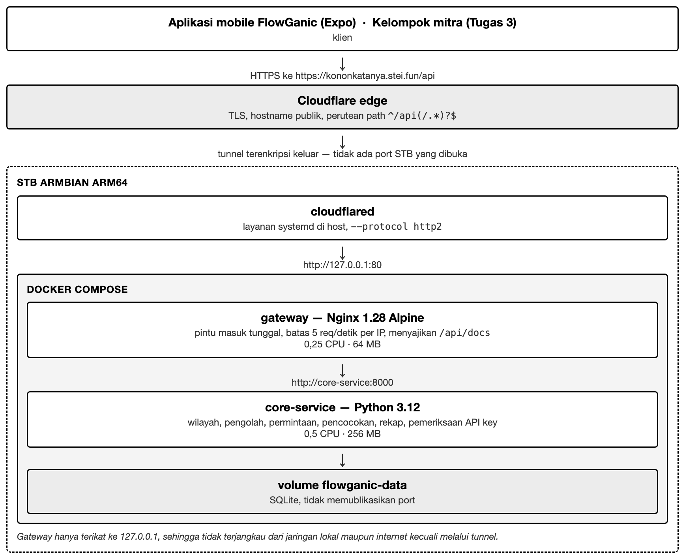{width=6.1in}

Gambar 1. Arsitektur aplikasi mobile dan microservice FlowGanic

## 1.1 Teknologi yang digunakan

Tabel 1 merangkum teknologi pada sisi aplikasi dan sisi layanan beserta fungsinya.

Tabel 1. Teknologi yang digunakan

| Komponen | Teknologi | Fungsi |
| --- | --- | --- |
| Aplikasi mobile | React Native 0.88 dan Expo SDK 58 | Membangun antarmuka untuk Android dan iOS |
| Navigasi | React Navigation (native stack dan bottom tabs) | Perpindahan antar layar dan menu tab bawah |
| Penyimpanan sesi | AsyncStorage | Menyimpan sesi login di perangkat |
| Pemanggilan API | `fetch` dengan pembungkus `ApiService` | Mengirim permintaan, menyisipkan API key, menangani galat dan batas waktu |
| Layanan inti | Python 3.12 standard library | Wilayah, pengolah, permintaan, pencocokan, dan rekap |
| Basis data | SQLite | Menyimpan wilayah, pengolah, kapasitas, dan permintaan |
| Gateway | Nginx 1.28 Alpine | Pintu masuk tunggal dan pembatas laju permintaan |
| Penerapan | Docker Compose dan Cloudflare Tunnel di STB | Menjalankan layanan dan membukanya ke internet |

## 1.2 Struktur proyek

Kode dipisah berdasarkan tanggung jawab agar mudah dipelihara, seperti pada Tabel 2. Layar hanya mengurus tampilan dan interaksi, sedangkan seluruh pemanggilan jaringan berada di `ApiService` dan status login berada di `SesiContext`.

Tabel 2. Struktur folder dan berkas

| Lokasi | Tanggung jawab |
| --- | --- |
| `core-service/app.py` | Model domain, pencocokan pengolah, rekap, pemeriksaan API key |
| `core-service/test_app.py` | Uji domain, aturan bisnis, lapisan HTTP, dan autentikasi |
| `gateway/nginx.conf` | Reverse proxy, batas laju, penyajian dokumentasi |
| `compose.yaml` | Definisi container beserta batas CPU dan memori |
| `openapi.yaml` | Kontrak tujuh endpoint, disajikan sebagai Swagger UI |
| `mobile/App.js` | Titik masuk: menyusun navigasi dan membungkus penyedia sesi |
| `mobile/src/api/ApiService.js` | Satu-satunya tempat pemanggilan HTTP keluar |
| `mobile/src/konteks/SesiContext.js` | Status login, simpan dan hapus sesi |
| `mobile/src/layar/` | Enam layar aplikasi |
| `mobile/src/ui/` | Komponen pakai-ulang, tema, dan titik ubah mobile first |

Aturan yang dipegang: layar tidak pernah memanggil `fetch` sendiri, selalu lewat `ApiService`, dan tidak ada URL maupun kunci yang ditulis di dalam kode karena semuanya dibaca dari berkas `.env`.

## 1.3 Pembagian domain

Rancangan Tugas 1 memecah domain menjadi tiga bounded context, dan pembagian itu dipertahankan apa adanya pada API seperti terlihat di Tabel 3. Konteks hilir hanya membaca hitungan dan volume, tidak pernah isi permintaan maupun identitas penghasil.

Tabel 3. Bounded context dan pemetaannya ke endpoint

| Bounded context | Peran | Endpoint |
| --- | --- | --- |
| Koordinasi Distribusi Sampah (core) | Pengajuan, pencocokan, penjadwalan, pelacakan status dan volume | `POST /permintaan`, `GET /permintaan/{id}`, `PATCH /permintaan/{id}` |
| Identitas dan Wilayah (supporting) | Wilayah layanan dan profil pengolah | `GET /wilayah`, `GET /pengolah` |
| Analitik dan Pelaporan (supporting) | Rekapitulasi agregat dan anonim | `GET /rekap` |

Tiga wilayah, empat pengolah, dan seluruh kapasitasnya adalah data contoh untuk menguji alur koordinasi, bukan data operasional Kota Bandung. Setiap respons memuat label `sumber` agar batasan ini terlihat oleh pemakai API.

```{=openxml}
<w:p><w:r><w:br w:type="page"/></w:r></w:p>
```

# BAB 2 NAVIGASI DAN LAYAR

Navigasi aplikasi memakai React Navigation dan terbagi dua jalur seperti pada Gambar 2. Pengguna yang belum memiliki sesi hanya mendapat satu layar, yaitu Masuk. Setelah login berhasil, stack terluar berpindah ke cabang Utama yang memiliki empat tab: Ajukan, Pengolah, Rekap, dan Profil. Layar DetailPermintaan didorong di atas bilah tab dari tab Ajukan, sehingga tombol kembali selalu membawa pengguna ke layar sebelumnya.

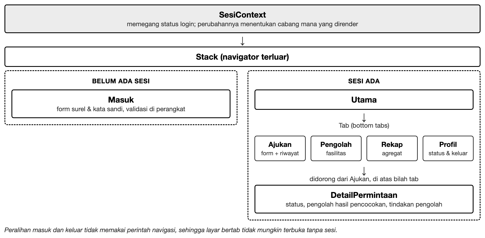{width=6.1in}

Gambar 2. Peta navigasi aplikasi FlowGanic

Peralihan masuk dan keluar tidak memakai perintah navigasi. `SesiContext` mengubah status, lalu stack merender cabang yang sesuai. Akibatnya layar bertab tidak mungkin terbuka tanpa sesi, dan tombol kembali tidak dapat mengembalikan pengguna ke halaman dalam setelah keluar.

## 2.1 Daftar layar

Tabel 4 merangkum enam layar beserta endpoint API yang dipanggil masing-masing.

Tabel 4. Daftar layar dan endpoint yang dipanggil

| Layar | Letak | Fungsi | Endpoint API |
| --- | --- | --- | --- |
| Masuk | Stack | Form surel dan kata sandi beserta validasinya | — |
| Ajukan | Tab | Pilih wilayah dan jenis, isi berat dan tanggal, lihat permintaan terakhir | `GET /wilayah`, `POST /permintaan`, `GET /permintaan/{id}` |
| Pengolah | Tab | Daftar fasilitas penerima dengan saringan wilayah dan jenis | `GET /wilayah`, `GET /pengolah` |
| Rekap | Tab | Total terkelola dan rincian per jenis sampah | `GET /wilayah`, `GET /rekap` |
| Profil | Tab | Identitas pengguna, base URL, cek status layanan, keluar | `GET /health` |
| DetailPermintaan | Stack | Status, pengolah hasil pencocokan, tindakan pengolah | `GET /permintaan/{id}`, `PATCH /permintaan/{id}` |

Tiap layar yang memanggil jaringan memiliki tiga keadaan: sedang memuat dengan indikator, berhasil, dan gagal dengan pesan beserta tombol coba lagi. Layar yang menampilkan data contoh selalu menyertakan label sumbernya, sehingga pengguna tidak menyangka itu informasi operasional.

## 2.2 Tampilan layar

Gambar 3 sampai Gambar 5 memperlihatkan layar-layar tersebut pada aplikasi yang berjalan, diambil 20 November 2026 pada viewport 420 x 900. Seluruh data pada gambar berasal dari pemanggilan API sungguhan, bukan tiruan. Pada sesi perekaman ini aplikasi diarahkan ke instans microservice lokal yang kodenya identik dengan yang berjalan di STB, agar API key produksi tidak ikut terekam dalam gambar. Itu sebabnya layar Profil menampilkan base URL lokal.

| | | |
| --- | --- | --- |
| 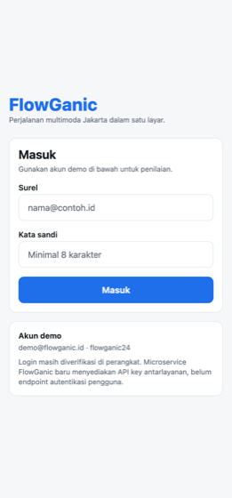{width=1.75in} | 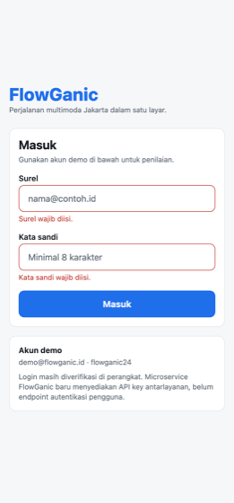{width=1.75in} | 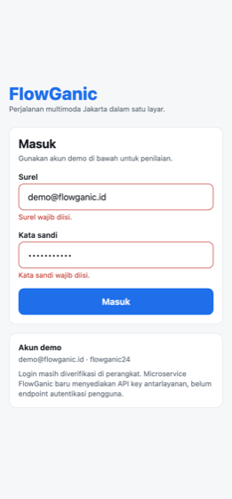{width=1.75in} |

Gambar 3. Layar Masuk (a), validasi kolom kosong (b), dan kredensial terisi (c)

Layar Masuk (Gambar 3a) meminta surel dan kata sandi. Menekan tombol Masuk tanpa mengisi apa pun memunculkan pesan kesalahan di bawah tiap kolom beserta garis tepi merah (Gambar 3b), dan tidak ada permintaan jaringan yang dikirim. Bila kedua kolom lolos validasi (Gambar 3c), kredensial dicocokkan dengan akun demo dan sesi disimpan.

| | |
| --- | --- |
| 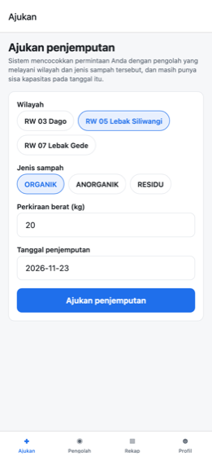{width=2.2in} | 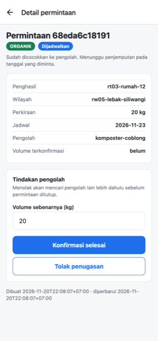{width=2.2in} |

Gambar 4. Layar Ajukan (a) dan Detail Permintaan (b)

Pada layar Ajukan (Gambar 4a) wilayah dan jenis sampah dipilih lewat chip, bukan picker, agar tetap nyaman disentuh pada layar sempit. Setelah dikirim, `POST /permintaan` mengembalikan permintaan beserta pengolah hasil pencocokan, dan aplikasi mendorong layar DetailPermintaan di atas tab melalui stack. Di layar itu (Gambar 4b) tampak status Dijadwalkan dan pengolah `komposter-coblong` yang dipilih sistem berdasarkan wilayah, jenis sampah, dan sisa kapasitas hari tersebut. Tombol Konfirmasi selesai dan Tolak penugasan memanggil `PATCH /permintaan/{id}`.

| | | |
| --- | --- | --- |
| 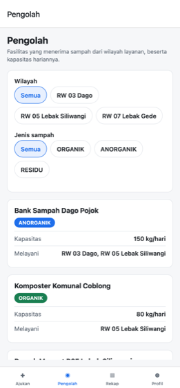{width=1.75in} | 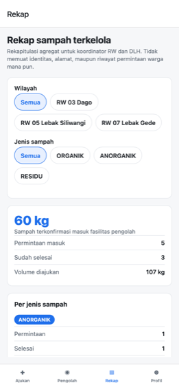{width=1.75in} | 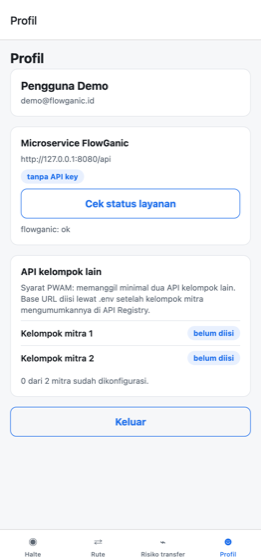{width=1.75in} |

Gambar 5. Layar Pengolah (a), Rekap (b), dan Profil (c)

Tab Pengolah (Gambar 5a) menyaring `GET /pengolah` per wilayah dan jenis, menampilkan kapasitas harian serta seluruh cakupan layanan tiap fasilitas. Tab Rekap (Gambar 5b) membaca `GET /rekap`: total sampah terkonfirmasi masuk fasilitas, jumlah permintaan, dan rincian per jenis. Inilah bentuk data yang akan dibagikan ke kelompok mitra pada Tugas 3, dan tidak satu pun barisnya menunjuk rumah tangga tertentu. Profil (Gambar 5c) memanggil `GET /health` dan menampilkan `flowganic: ok`.

Keempat tab terlihat pada bilah bawah di setiap gambar dan tab yang sedang aktif ditandai berbeda. Itu bukti navigasi tab bekerja, sedangkan layar DetailPermintaan yang tampil dengan tombol kembali dan tanpa bilah tab adalah bukti stack bekerja.

```{=openxml}
<w:p><w:r><w:br w:type="page"/></w:r></w:p>
```

# BAB 3 LOGIN DAN AUTENTIKASI

Autentikasi adalah proses memastikan siapa yang mengakses layanan. FlowGanic melayani dua jenis pihak dengan cara berbeda, seperti pada Tabel 5. Pengguna aplikasi mobile masuk melalui layar Masuk, sedangkan kelompok lain memakai API key karena mereka memanggil layanan dari server, bukan atas nama seorang warga.

Tabel 5. Cara akses menurut jenis pihak

| Pihak | Kredensial | Cakupan akses |
| --- | --- | --- |
| Pengguna aplikasi | Sesi lokal, permintaan membawa API key aplikasi | Wilayah, pengolah, pengajuan dan pelacakan permintaan, rekap |
| Kelompok lain | `X-API-Key: <kunci>` | Dibatasi pada `/wilayah`, `/pengolah`, dan `/rekap` |
| Siapa pun | Tanpa kredensial | `/health` dan `/docs` |

## 3.1 Validasi dan penyimpanan sesi

Validasi dijalankan di perangkat sebelum apa pun dikirim. Surel wajib diisi dan harus berpola `nama@domain.tld`, sedangkan kata sandi wajib diisi dan minimal delapan karakter. Pesan galat muncul tepat di bawah kolom yang bersangkutan dan kolomnya diberi garis tepi berbeda. Bila keduanya lolos, kredensial dicocokkan dengan akun demo `demo@flowganic.id`, lalu sesi disimpan ke AsyncStorage sehingga pengguna tetap masuk setelah aplikasi ditutup.

Login ini diverifikasi di perangkat, bukan di server. Microservice FlowGanic baru menyediakan API key antarlayanan dan belum memiliki endpoint autentikasi pengguna, jadi belum ada token yang diterbitkan server. Batasan ini ditulis terbuka pada layar Masuk agar tidak disalahartikan sebagai autentikasi sungguhan. Bila endpoint autentikasi ditambahkan kelak, hanya `SesiContext` dan `ApiService` yang perlu berubah dan layar tidak tersentuh. Pengguna diwakili kode anonim `rt03-rumah-12`, bukan nama atau alamat, sesuai batasan privasi pada Tugas 1.

## 3.2 Penanganan kondisi

Tabel 6 merangkum apa yang terjadi pada tiap kondisi, baik saat login maupun saat memanggil API.

Tabel 6. Kondisi dan perilaku aplikasi

| Kondisi | Respons | Perilaku aplikasi |
| --- | --- | --- |
| Kolom kosong atau format surel salah | — | Pesan kesalahan di bawah kolom, tidak ada permintaan ke server |
| Kata sandi salah | — | Menampilkan "Surel atau kata sandi salah" |
| Masukan ditolak layanan | 400 | Menampilkan pesan dari server, misalnya jadwal sudah lewat |
| API key ditolak | 401 | Menampilkan "API key ditolak layanan" |
| Data tidak ditemukan | 404 | Menampilkan pesan dari server, misalnya wilayah tidak ditemukan |
| Terlalu sering memanggil | 429 | Meminta pengguna mencoba lagi sebentar lagi |
| Lebih dari 10 detik tanpa jawaban | — | Permintaan dibatalkan, pesan layanan tidak menjawab tepat waktu |
| Jaringan mati | — | Pesan tidak dapat menghubungi layanan beserta tombol coba lagi |

## 3.3 Aturan keamanan

API key tidak pernah disimpan di repositori. Nilainya hanya ada pada berkas `.env` di STB, dibuat dengan `openssl rand -hex 24`, dan dibandingkan di sisi server memakai `hmac.compare_digest` agar tidak bocor lewat perbedaan waktu pembandingan. Endpoint `/health` sengaja dibiarkan terbuka supaya status layanan dan tunnel dapat diperiksa tanpa kredensial. Gateway membatasi lima permintaan per detik per alamat IP dengan burst 20, dan core service maupun basis data tidak memublikasikan port sama sekali.

```{=openxml}
<w:p><w:r><w:br w:type="page"/></w:r></w:p>
```

# BAB 4 API

Aplikasi memanggil microservice milik kelompok sendiri yang dapat diakses publik di https://kononkatanya.stei.fun/api. Service ini berjalan di STB sebagai dua container Docker dengan batas memori dan CPU seperti pada Tabel 7, ditambah cloudflared sebagai layanan systemd di host. Seluruhnya memakai `restart: unless-stopped` sehingga menyala kembali bila STB dimulai ulang. Kode sumbernya berada di https://github.com/tepchu/FlowGanic, sedangkan dokumentasi interaktif Swagger tersedia di https://kononkatanya.stei.fun/api/docs.

Tabel 7. Container pada STB

| Container | Fungsi | Batas sumber daya |
| --- | --- | --- |
| `gateway` | Nginx, pintu masuk tunggal dan pembatas laju | 64 MB, 0,25 CPU |
| `core-service` | Python 3.12: wilayah, pengolah, permintaan, pencocokan, rekap | 256 MB, 0,5 CPU |
| `cloudflared` | Menghubungkan STB ke Cloudflare, layanan systemd di host | tanpa batas container |

## 4.1 Daftar endpoint

Seluruh alamat pada Tabel 8 diawali https://kononkatanya.stei.fun/api. Kolom Kunci menunjukkan apakah header `X-API-Key` diperlukan.

Tabel 8. Daftar endpoint API FlowGanic

| Metode | Path | Kunci | Fungsi |
| --- | --- | --- | --- |
| GET | `/health` | tidak | Memeriksa layanan hidup |
| GET | `/wilayah` | ya | Wilayah layanan, wilayah pilot ditandai |
| GET | `/pengolah?wilayah_id=&jenis=` | ya | Pengolah, kapasitas harian, dan cakupan layanan |
| POST | `/permintaan` | ya | Mengajukan penjemputan dan menerima hasil pencocokan |
| GET | `/permintaan/{id}` | ya | Status terkini sebuah permintaan |
| PATCH | `/permintaan/{id}` | ya | Menolak penugasan atau mengonfirmasi volume |
| GET | `/rekap?wilayah_id=&jenis=&dari=&sampai=` | ya | Total dan rincian agregat per jenis |

Status permintaan ada empat: `diajukan` berarti belum ada pengolah yang sanggup pada tanggal itu, `dijadwalkan` berarti sudah dicocokkan, `ditolak` berarti tidak ada pengolah yang dapat melayani, dan `selesai` berarti volume sudah dikonfirmasi. Kode status yang dipakai adalah 200 (berhasil), 400 (masukan tidak valid atau permintaan sudah final), 401 (API key salah atau belum disertakan), 404 (data tidak ditemukan), dan 429 (melewati batas pemanggilan).

## 4.2 Alur inti

Gambar 6 memperlihatkan alur dari pengajuan sampai rekap, termasuk letak dua aturan bisnis Tugas 1 yang dikunci oleh uji otomatis.

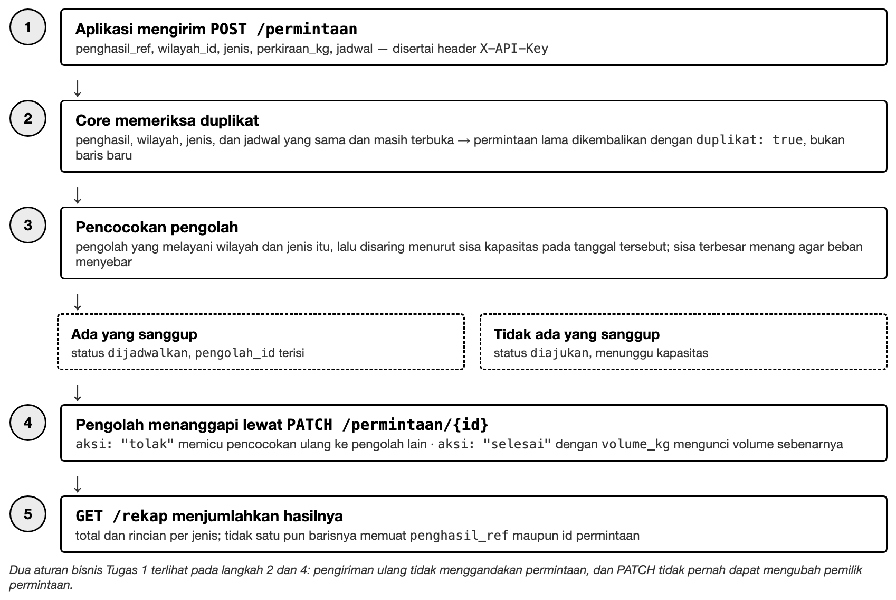{width=6.1in}

Gambar 6. Alur pengajuan penjemputan dan pencocokan pengolah

## 4.3 Contoh permintaan dan jawaban

Contoh berikut mengajukan penjemputan sampah organik seberat 20 kg di wilayah pilot.

```
POST /api/permintaan
X-API-Key: <kunci>
Content-Type: application/json

{"penghasil_ref":"rt03-rumah-12",
 "wilayah_id":"rw05-lebak-siliwangi",
 "jenis":"ORGANIK","perkiraan_kg":20,
 "jadwal":"2026-11-25"}
```

Jawaban server berisi permintaan beserta pengolah hasil pencocokan:

```
{"id":"68eda6c18191","penghasil_ref":"rt03-rumah-12",
 "wilayah_id":"rw05-lebak-siliwangi","jenis":"ORGANIK",
 "perkiraan_kg":20,"jadwal":"2026-11-25",
 "status":"dijadwalkan","pengolah_id":"komposter-coblong",
 "volume_kg":null,"duplikat":false}
```

Saat sampah benar-benar diterima, pengolah mengunci volume sebenarnya, lalu rekap menjumlahkannya secara anonim:

```
PATCH /api/permintaan/68eda6c18191
{"aksi":"selesai","volume_kg":23}

GET /api/rekap?wilayah_id=rw05-lebak-siliwangi
{"total":{"permintaan":4,"selesai":3,
          "terkelola_kg":60,"diajukan_kg":87},
 "per_jenis":{"ORGANIK":{"permintaan":2,"selesai":2,"terkelola_kg":48},
              "ANORGANIK":{"permintaan":1,"selesai":1,"terkelola_kg":12},
              "RESIDU":{"permintaan":1,"selesai":0,"terkelola_kg":0}},
 "sumber":"agregat_anonim"}
```

Permintaan tanpa header `X-API-Key` dijawab `401` dengan isi `{"galat": "API key tidak valid atau belum disertakan"}`.

## 4.4 Pengujian

Pengujian dilakukan pada tiga tingkat, seperti pada Tabel 9.

Tabel 9. Ringkasan pengujian

| Tingkat | Cakupan | Hasil |
| --- | --- | --- |
| Uji unit (`python3 -m unittest`) | Model domain, pencocokan kapasitas, aturan anti-duplikat, pemilik tetap, anonimitas rekap, lapisan HTTP, API key, CORS | 17 uji lulus |
| Uji HTTP (`cek-api.sh`) | Alur lengkap dari pengajuan, penolakan, pencocokan ulang, sampai konfirmasi volume dan rekap | 14 dari 14 lulus |
| Uji dari luar jaringan STB | `GET /api/health` menjawab 200 melalui HTTP/2 over TLS, endpoint berkunci menjawab 401, batas CPU dan memori terbaca `500000000`/`268435456` dan `250000000`/`67108864` di kernel STB | Sesuai rancangan |

Belum diuji: beban bersamaan, perilaku setelah listrik STB padam, dan tampilan aplikasi pada perangkat fisik. Branding aplikasi serta build APK release juga belum dikerjakan. Integrasi dengan API kelompok lain berada di luar lingkup dokumen ini dan dikerjakan pada Tugas 3; kerangkanya sudah disiapkan pada objek `MITRA` di `ApiService.js` dengan base URL sengaja dibiarkan kosong.
