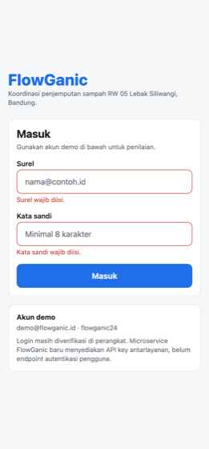
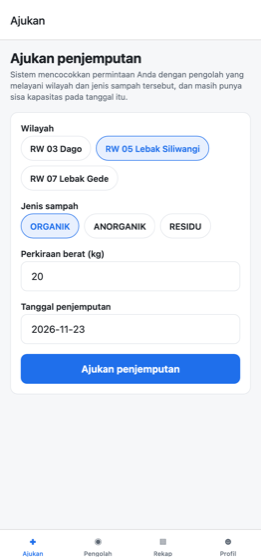
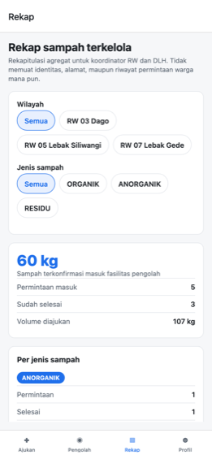

# FlowGanic Mobile

Aplikasi React Native (Expo) untuk II3140 PWAM. Mengonsumsi microservice FlowGanic, platform koordinasi distribusi sampah Kota Bandung, yang berjalan di STB dan dapat diakses publik di `https://kononkatanya.stei.fun/api`.

| | |
| --- | --- |
| Kerangka | Expo SDK 58, React Native 0.88, React 19 |
| Navigasi | React Navigation: native stack + bottom tabs |
| Bahasa | JavaScript, tanpa TypeScript |
| Penyimpanan sesi | AsyncStorage |
| Akun demo | `demo@flowganic.id` / `flowganic24` |

## Kerangka aplikasi

Struktur dipisah menurut peran agar tiap bagian dapat diuji dan diganti sendiri-sendiri.

| Path | Peran |
| --- | --- |
| `App.js` | Menyusun navigasi dan membungkus aplikasi dengan penyedia sesi |
| `src/api/ApiService.js` | Satu-satunya tempat pemanggilan HTTP keluar |
| `src/api/konfigurasi.js` | Base URL, API key, akun demo, kode penghasil |
| `src/konteks/SesiContext.js` | Status login, simpan dan hapus sesi |
| `src/layar/` | Lima layar aplikasi |
| `src/ui/komponen.js` | Komponen pakai-ulang: Wadah, Kartu, Kolom, Pilihan, Baris, Tombol, Pesan, Lencana |
| `src/ui/responsif.js` | Titik ubah mobile first |
| `src/ui/tema.js` | Warna jenis sampah, warna status, jarak |

Aturan yang dipegang: layar tidak pernah memanggil `fetch` sendiri, selalu lewat `ApiService`. Tidak ada URL atau kunci yang ditulis di dalam kode; semuanya dari `.env`.

## Navigasi

Dua lapis. Stack terluar menentukan pengguna sudah masuk atau belum; tab hanya hidup setelah login.

```
Stack (navigator terluar)
│
├── Masuk                      ← tampil bila belum ada sesi
│
└── Utama                      ← tampil bila sesi ada
    │
    ├── Tab
    │   ├── Ajukan             form penjemputan + permintaan terakhir
    │   ├── Pengolah           fasilitas penerima dan kapasitasnya
    │   ├── Rekap              rekapitulasi agregat
    │   └── Profil             status layanan dan keluar
    │
    └── DetailPermintaan       ← didorong dari Ajukan
```

Peralihan masuk dan keluar tidak memakai perintah navigasi. `SesiContext` mengubah status, lalu stack merender cabang yang sesuai. Akibatnya layar bertab tidak mungkin terbuka tanpa sesi, dan tombol kembali tidak dapat mengembalikan pengguna ke halaman dalam setelah keluar.

## Layar

| Layar | Letak | Isi | Endpoint |
| --- | --- | --- | --- |
| Masuk | Stack | Form surel dan kata sandi, validasi, pesan galat | — |
| Ajukan | Tab | Pilih wilayah dan jenis, isi berat dan tanggal, lalu daftar permintaan terakhir | `GET /wilayah`, `POST /permintaan`, `GET /permintaan/{id}` |
| Pengolah | Tab | Daftar fasilitas dengan saringan wilayah dan jenis | `GET /wilayah`, `GET /pengolah` |
| Rekap | Tab | Total terkelola dan rincian per jenis sampah | `GET /wilayah`, `GET /rekap` |
| Profil | Tab | Identitas pengguna, base URL, cek status layanan, status mitra, keluar | `GET /health` |
| DetailPermintaan | Stack | Status, pengolah hasil pencocokan, tindakan pengolah | `GET /permintaan/{id}`, `PATCH /permintaan/{id}` |

Tiap layar yang memanggil jaringan memiliki tiga keadaan: sedang memuat dengan indikator, berhasil, dan gagal dengan pesan beserta tombol coba lagi. Layar yang menampilkan data contoh selalu menyertakan label sumbernya, sehingga pengguna tidak menyangka itu informasi operasional.

## Login dan sesi

Validasi dijalankan di perangkat sebelum apa pun dikirim:

| Kolom | Aturan |
| --- | --- |
| Surel | Wajib diisi, harus berpola `nama@domain.tld` |
| Kata sandi | Wajib diisi, minimal 8 karakter |

Pesan galat muncul tepat di bawah kolom yang bersangkutan, dan kolomnya diberi garis tepi berbeda. Bila keduanya lolos, kredensial dicocokkan dengan akun demo; bila cocok, sesi disimpan ke AsyncStorage sehingga pengguna tetap masuk setelah aplikasi ditutup.

Login ini **diverifikasi di perangkat, bukan di server**. Microservice FlowGanic baru menyediakan API key antarlayanan dan belum memiliki endpoint autentikasi pengguna, jadi belum ada token yang diterbitkan server. Batasan ini ditulis terbuka di layar Masuk agar tidak disalahartikan sebagai autentikasi sungguhan. Bila endpoint autentikasi ditambahkan kelak, hanya `SesiContext` dan `ApiService` yang perlu berubah; layar tidak tersentuh.

Pengguna diwakili kode anonim `rt03-rumah-12`, bukan nama atau alamat, sesuai batasan privasi pada Tugas 1.

## Pemanggilan API sendiri

Seluruh lalu lintas keluar melewati satu fungsi di `ApiService.js` yang menangani batas waktu, penyisipan header, penguraian JSON, dan penyeragaman galat.

| Fungsi | Memanggil |
| --- | --- |
| `ApiFlowGanic.cekKesehatan()` | `GET /health`, sengaja tanpa kunci |
| `ApiFlowGanic.ambilWilayah()` | `GET /wilayah` |
| `ApiFlowGanic.ambilPengolah(wilayahId, jenis)` | `GET /pengolah` |
| `ApiFlowGanic.ajukanPermintaan({...})` | `POST /permintaan` |
| `ApiFlowGanic.lacakPermintaan(id)` | `GET /permintaan/{id}` |
| `ApiFlowGanic.perbaruiPermintaan(id, aksi, volumeKg)` | `PATCH /permintaan/{id}` |
| `ApiFlowGanic.ambilRekap({...})` | `GET /rekap` |

Header `X-API-Key` disisipkan otomatis bila `EXPO_PUBLIC_API_KEY` terisi. Permintaan dibatalkan setelah 10 detik agar aplikasi tidak menggantung saat jaringan buruk. Setiap kegagalan dilempar sebagai `GalatApi` dengan pesan berbahasa Indonesia yang layak ditampilkan ke pengguna:

| Keadaan | Pesan |
| --- | --- |
| Kode 400 | Pesan dari server, misalnya jadwal sudah lewat |
| Kode 401 | API key ditolak layanan |
| Kode 404 | Pesan dari server, misalnya wilayah tidak ditemukan |
| Kode 429 | Terlalu sering memanggil, coba lagi sebentar lagi |
| Batas waktu | Layanan tidak menjawab tepat waktu |
| Jaringan mati | Tidak dapat menghubungi layanan, periksa koneksi |

Kerangka pemanggilan API kelompok lain sudah disiapkan pada objek `MITRA`, namun base URL-nya sengaja dibiarkan kosong karena integrasi lintas kelompok merupakan lingkup Tugas 3.

## Tangkapan layar

Diambil pada 20 November 2026 dari aplikasi yang berjalan, viewport 420 × 900. Seluruh data pada gambar berasal dari pemanggilan API sungguhan, bukan tiruan.

Pada sesi ini aplikasi diarahkan ke instans microservice lokal yang kodenya identik dengan yang berjalan di STB, sehingga API key produksi tidak ikut terekam dalam gambar. Itu sebabnya layar Profil menampilkan base URL lokal.

### Login dan validasi

| Layar Masuk | Validasi kolom kosong | Kredensial terisi |
| --- | --- | --- |
|  |  |  |

Menekan **Masuk** tanpa mengisi apa pun memunculkan pesan galat di bawah tiap kolom beserta garis tepi merah, dan tidak ada permintaan jaringan yang dikirim.

### Alur inti: mengajukan dan melacak penjemputan

| Ajukan penjemputan | Detail permintaan |
| --- | --- |
|  |  |

Wilayah dan jenis sampah dipilih lewat chip, bukan picker, agar tetap nyaman disentuh pada layar sempit. Setelah dikirim, `POST /permintaan` mengembalikan permintaan beserta pengolah hasil pencocokan, dan aplikasi mendorong layar DetailPermintaan di atas tab melalui stack. Di layar itu tampak status `Dijadwalkan` dan pengolah `komposter-coblong` yang dipilih sistem berdasarkan wilayah, jenis sampah, dan sisa kapasitas hari tersebut. Tombol **Konfirmasi selesai** dan **Tolak penugasan** memanggil `PATCH /permintaan/{id}`.

### Pengolah dan rekap

| Pengolah | Rekap |
| --- | --- |
|  |  |

Tab Pengolah menyaring `GET /pengolah` per wilayah dan jenis, menampilkan kapasitas harian serta seluruh cakupan layanan tiap fasilitas. Tab Rekap membaca `GET /rekap`: total sampah terkonfirmasi masuk fasilitas, jumlah permintaan, dan rincian per jenis. Inilah bentuk data yang dibagikan ke kelompok mitra pada Tugas 3, dan tidak satu pun barisnya menunjuk rumah tangga tertentu.

| Profil |
| --- |
|  |

Profil memanggil `GET /health` dan menampilkan `flowganic: ok`, sekaligus menunjukkan status konfigurasi mitra Tugas 3 yang memang belum diisi.

Keempat tab terlihat pada bilah bawah di setiap gambar, dan tab yang sedang aktif ditandai berbeda dari yang lain. Itu bukti navigasi tab bekerja; layar DetailPermintaan yang tampil dengan tombol kembali dan tanpa bilah tab adalah bukti stack bekerja.

## Menjalankan

Syarat: Node.js 22 dan npm.

```sh
cd mobile
npm install
cp .env.example .env
```

Isi `EXPO_PUBLIC_API_KEY` pada `.env` dengan kunci dari kelompok. `EXPO_PUBLIC_API_URL` sudah menunjuk layanan publik, sehingga aplikasi tidak memerlukan backend lokal maupun jaringan yang sama dengan STB.

```sh
npx expo start
```

Tekan `w` untuk peramban, `a` untuk emulator Android, atau pindai kode QR dengan Expo Go pada perangkat sungguhan. Masuk memakai akun demo di tabel paling atas.

| Variabel | Isi |
| --- | --- |
| `EXPO_PUBLIC_API_URL` | Base URL microservice, berakhiran `/api` |
| `EXPO_PUBLIC_API_KEY` | API key, dikirim sebagai header `X-API-Key` |
| `EXPO_PUBLIC_MITRA1_*` | Disiapkan untuk Tugas 3, dibiarkan kosong |
| `EXPO_PUBLIC_MITRA2_*` | Disiapkan untuk Tugas 3, dibiarkan kosong |

## Pendekatan mobile first

Gaya dasar ditulis untuk layar ponsel paling sempit tanpa mengasumsikan ruang lebih. Penyesuaian hanya ditambahkan ketika lebar layar mencapai minimum tertentu, sejalan dengan pola `min-width`.

| Titik ubah | Lebar minimum | Penyesuaian |
| --- | --- | --- |
| dasar | 0 | Satu kolom, padding 16, chip membungkus ke baris berikutnya |
| sedang | 600 | Lebar konten dibatasi 680, padding 24, judul membesar |
| lebar | 900 | Lebar konten dibatasi 900 |

React Native tidak mengenal media query CSS, jadi titik ubah dibaca lewat `useWindowDimensions` pada `src/ui/responsif.js`. Pembantu `perLebar({ dasar, sedang, lebar })` mewajibkan nilai `dasar` dan hanya menimpanya bila ambang tercapai, sehingga tata letak ponsel menjadi jalur bawaan, bukan hasil penyusutan dari tata letak lebar.

Target sentuh tombol, chip, dan kolom isian dijaga minimal 40 pt. Semua layar memakai `ScrollView` agar tetap terpakai pada layar pendek ketika papan ketik terbuka.

## Status

| Bagian | Keadaan |
| --- | --- |
| Kerangka, navigasi stack dan tab, lima layar | Selesai |
| Login dan form dengan validasi | Selesai, diverifikasi di perangkat |
| Pemanggilan ketujuh endpoint microservice sendiri | Selesai, teruji terhadap layanan yang berjalan |
| Panggilan API kelompok lain | Lingkup Tugas 3, kerangka sudah disiapkan |
| Branding, ikon, splash | Belum dikerjakan |
| Build APK release | Belum dikerjakan |

Belum diuji: tampilan pada perangkat fisik dan alur login melalui antarmuka perangkat sungguhan.
